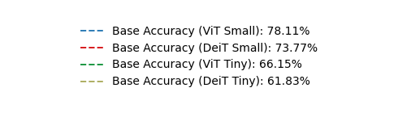
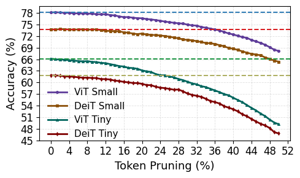
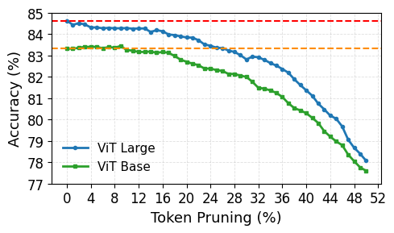
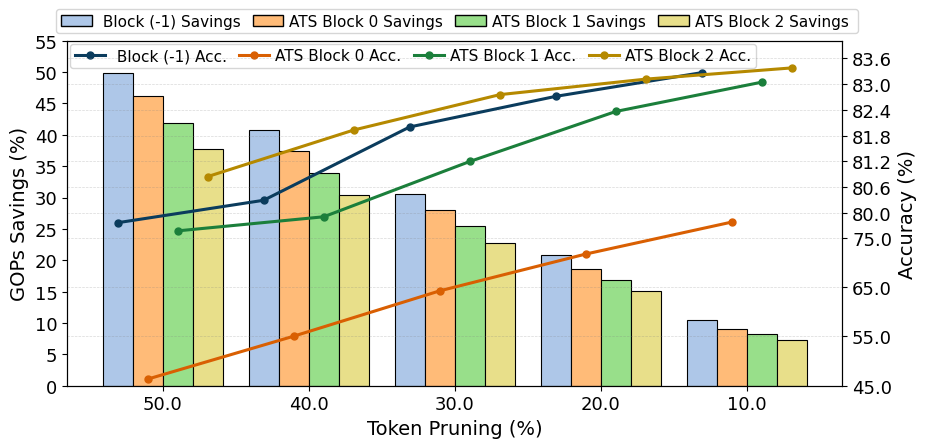
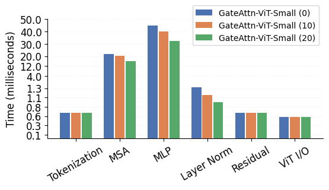

# GateAttn-ViT

**Entropy-gated, attention-guided token pruning for resource-efficient Vision Transformer acceleration on FPGAs.**

Research companion for Akshansh Yadav and Palash Das, *Journal of Systems Architecture* **177** (2026), 103836. [Published paper](https://doi.org/10.1016/j.sysarc.2026.103836).

This repository packages the supplied `entropy_experiments` notebook collection as a reusable Python implementation, a complete experiment archive, machine-readable results, and reproducible visualization tools.

## Research paper graphs

Original saved graph outputs from the [author-provided Colab notebook](https://colab.research.google.com/drive/1Of57FctGySefxJt7GaN-1cbma_IRbtX1), selected against Figures 7–9 in `JSA_main.pdf`. [Source mapping and presentation differences](figures/paper/README.md).

**Figure 7 — Accuracy–pruning trade-off**

| ViT/DeiT Small and Tiny | ViT Base and Large |
| --- | --- |
|  |  |
|  |  |

**Figure 8 — Accuracy–GOPs trade-off across pruning blocks**



**Figure 9 — GateAttn-ViT latency breakdown**



## What is included

- **EDPG:** grayscale or pooled-RGB Shannon entropy, input patch selection, configurable cutoff and tie handling.
- **ATS:** mean CLS attention, progressive pruning after configurable transformer blocks, and original spatial coordinates retained for visualization.
- **Baselines:** unpruned inference, seeded random token dropping, original square center selection, and an exact-count center variant.
- **Quantization:** optional notebook-style fixed-point simulation for Linear/Conv2d weights, biases, and input activations.
- **Experiments:** ViT and DeiT configurations, entropy sweeps, combined EDPG/ATS sweeps, pruning placement studies, and baseline comparisons.
- **Visualizations:** entropy maps, binary masks, faded dropped-patch images, every-block attention grids and overlays, unpruned/pruned comparisons, and result plots exported as **PDF, SVG, and 300-dpi PNG**.
- **Complete preservation:** **1,060 notebooks** (960 regular notebooks and 100 checkpoints), **1,060 guarded Python exports**, every saved notebook output, and all 47 original text logs. All **6,162 source files** are listed with SHA-256 checksums.
- **Results:** all eight paper tables (Table 4 has two CSVs), Figure 9 latency data, **50,738 notebook accuracy observations**, and **55,595 text-log observations**, with provenance kept separate.

**The complete experiment is tracked in Git.** All 6,162 original files—including the paper, dataset archives, annotations, images, and exact notebook bytes—are included through Git LFS. Reusable code, documentation, extracted results, and run records are included too; standalone generated run images are excluded. See [archive layout and restoration](docs/ARCHIVE.md).

Install Git LFS before cloning, then run `git lfs pull` inside the clone to retrieve every original file. LFS pointer files alone are not the dataset; the associated objects must be pushed to the remote alongside Git commits. See [publishing instructions](docs/PUBLISHING.md).

## Quick start

Follow the [step-by-step usage guide](docs/GETTING_STARTED.md) for installation, paper graphs, evaluation, and original notebooks.

```bash
git lfs install
git clone https://github.com/IITjodhpurbuddy/GateAttn-ViT.git
cd GateAttn-ViT
git lfs pull
```

Python **3.10** is the validated environment. Run from the repository root:

```bash
python -m venv .venv
source .venv/bin/activate
python -m pip install --upgrade pip
# CPU environment; use the appropriate PyTorch build for CUDA instead if needed.
python -m pip install torch==2.3.1 torchvision==0.18.1 --index-url https://download.pytorch.org/whl/cpu
python -m pip install -r requirements.txt
python -m pip install -e . --no-deps
```

On Windows, activate with `.venv\Scripts\Activate.ps1` in PowerShell. Installation may download dependencies; the figure commands below do not need pretrained weights or datasets.

```bash
# Extract the selected original Colab outputs without rerunning plotting code.
python tools/extract_paper_figures.py

# Verify the portable notebook archive and run CPU tests.
python tools/verify_archive.py --local --git-tracked
python -m unittest discover -s tests -v
```

## Evaluate on your images

Arrange a labeled dataset as `DATA_ROOT/class_directory/image.jpg`. Supply the mapping from each class directory to the model's output index. The loader accepts either `{ "n01440764": 0, ... }` or standard ImageNet class-index JSON `{ "0": ["n01440764", "tench"], ... }`. **A dataset subset must retain the original model indices.** [Data setup](docs/DATA.md) explains this requirement.

```bash
gateattn-evaluate \
  --config configs/vit_base_combined.json \
  --data /path/to/imagenet/val \
  --class-map /path/to/imagenet_class_index.json \
  --device cuda:0 \
  --output runs/vit_base_15_15_15_15
```

Use `--device cpu` for CPU inference and `--max-images 100` for a limited run. Pretrained weights are downloaded through timm unless `--checkpoint /path/to/weights.pth` is supplied. `--random-init` is available only for explicit software smoke tests; outputs label that setting.

Every evaluation writes the resolved configuration, package versions, weight checksum, class-map checksum, per-image hashes and predictions, actual per-block token counts, timing scope, and final accuracy. Output directories must be new to prevent accidental overwriting of results.

Configurations use **zero-based ATS block indices**. The paper's `−1/3/6/9` means entropy gating before block 0 and attention pruning after Python block indices 3, 6, and 9. Rates are fractions in configuration files: `0.15` means 15%.

## Reproduce visualizations

```bash
gateattn-visualize \
  --config configs/vit_base_combined.json \
  --image /path/to/image.jpg \
  --compare-unpruned \
  --device cuda:0 \
  --output runs/attention-example
```

The command exports entropy and retention panels, per-block attention grids, per-block overlays, numerical arrays, and metadata. Pruned positions remain mapped to the original patch grid. The unpruned comparison uses the same checkpoint, preprocessing, and quantization.

Original visualization code is preserved in [`archive/python/visualization`](archive/python/visualization), [`archive/python/vision_pipeline`](archive/python/vision_pipeline), and every other experiment folder. See the [visualization guide](docs/VISUALIZATIONS.md) to restore and extract the original saved figures.

## Run experiment sweeps

```bash
# Write configurations only; does not run inference.
python tools/sweep.py --suite combined --output runs/combined-configs

# Entropy sweep, 0% through 50%; add --run with dataset arguments to execute.
python tools/sweep.py --suite entropy \
  --rates 0 .1 .2 .3 .4 .5 --output runs/entropy-configs

# Placement: EDPG at -1 versus ATS after blocks 0, 1, and 2.
python tools/sweep.py --suite placement --output runs/placement-configs

# Random seeds are explicit for the random-drop baseline.
python tools/sweep.py --suite baselines --seeds 0 1 2 \
  --output runs/baseline-configs
```

See [reproduction details and execution examples](docs/REPRODUCIBILITY.md) and the [validation record](docs/VALIDATION.md).

## Repository map

| Path | Contents |
| --- | --- |
| `src/gateattn/` | Importable methods, evaluation, visualization, and result plotting |
| `configs/` | ViT/DeiT experiment settings and class-map example |
| `notebooks/` | Small walkthrough using the reusable API |
| `results/paper/` | Published values with explicit paper/table provenance |
| `results/extracted/` | Saved notebook/log observations, without completion assumptions |
| `figures/paper/` | Original Colab outputs corresponding to Figures 7–9, with source hashes |
| `archive/notebooks/` | Every original notebook with outputs stored separately |
| `archive/python/` | One Python export per notebook, preserving code and cell order |
| `archive/output_index/`, `archive/output_objects/` | Lossless saved output storage and reconstruction maps |
| `archive/files/` | Original text logs and other portable source files |
| `archive/manifest.json`, `archive/notebook_catalog.json` | Full file coverage, hashes, settings, functions, and saved run states |
| `archive/originals/` | Exact original notebook bytes, tracked through Git LFS |
| `local_assets/` | Exact original images, datasets, annotations, and PDF, tracked through Git LFS |
| `runs/` | Generated evaluation, visualization, restoration, and smoke-test outputs |
| `tools/`, `tests/`, `.github/workflows/` | Archival utilities, sweeps, CPU tests, and CI |
| `docs/` | Method, data, archive, experiment, visualization, and provenance guides |

## Reproducibility scope

The repository preserves the supplied experiments and provides tested software inference and plotting tools. **Full ImageNet accuracy was not rerun during packaging.** Checkpoints and the external ImageNet class mapping used by the original notebooks were not inside the supplied folder.

The portable implementation defaults to the original notebooks' preprocessing and selection conventions. Standard timm preprocessing and exact-count ATS are explicit alternatives. Changes to evaluation mode, preprocessing, model aliases, tie handling, or quantization can change accuracy; see [method conventions](docs/METHOD.md).

The supplied folder contains no HLS/RTL source, FPGA project, bitstream, or synthesis report. Hardware, Swin, CIFAR-100, and ObjectNet values from the paper are retained as published table data; this repository does not claim to reproduce those measurements from absent source artifacts. [Paper-to-code coverage](docs/PAPER_TO_CODE.md) records the available evidence for each result family.

## Citation and licensing

```bibtex
@article{yadav2026gateattn,
  title   = {GateAttn-ViT: Entropy-gated, attention-guided token pruning for resource-efficient Vision Transformer acceleration on FPGAs},
  author  = {Yadav, Akshansh and Das, Palash},
  journal = {Journal of Systems Architecture},
  volume  = {177},
  pages   = {103836},
  year    = {2026},
  doi     = {10.1016/j.sysarc.2026.103836}
}
```

A machine-readable citation is provided in [CITATION.cff](CITATION.cff). The code license has not yet been selected by the rights holder; see [LICENSE.md](LICENSE.md). The publisher PDF and third-party datasets are included as requested and retain their existing rights and terms.
